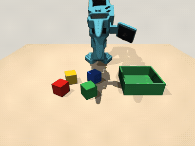
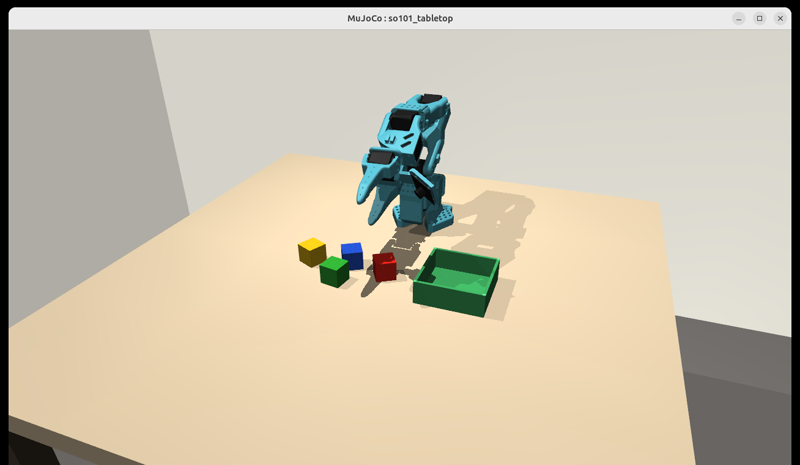
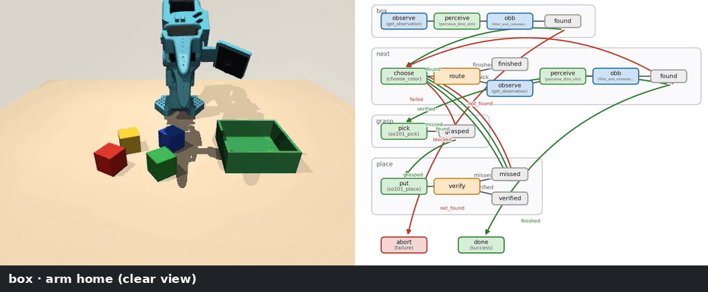

<h1 align="center">Graph-as-Policy × LeRobot SO-101 on NVIDIA Jetson AGX Orin</h1>

<p align="center">
  <b>Colour-cube sorting with a typed skill graph: perception, VLM reasoning, IK and simulation, all on one Jetson AGX Orin</b>
</p>

<p align="center">
  
  
  
  
  
</p>

<p align="center">
  
  &nbsp;
  
</p>

An SO-101 arm picks four wooden cubes (red, green, blue, yellow) **in a colour order you choose** and
puts each one in **its own quadrant** of a green box. The task is not a single learned policy. It is a
[Graph-as-Policy (GaP)](https://github.com/graph-robots/graph-as-policy) graph made of explicit skills:

- **Perception:** Grounding DINO proposes boxes, a VLM tournament picks the right one, SAM3 segments it,
  and depth turns the mask into a 3D box.
- **Motion:** top-down picking and placing with a custom IK solver for the 5-DOF SO-101.
- **Verification:** after each placement a VLM checks whether that colour's cube is in the box.

The scene is LeRobot's EnvHub [`lerobot/so101-tabletop-mujoco`](https://huggingface.co/lerobot/so101-tabletop-mujoco).
Everything runs on one Orin: the MuJoCo sim, the GaP executor, perception, and the VLM
([NVIDIA Nemotron-3-Nano-Omni](https://huggingface.co/ggml-org/NVIDIA-Nemotron-3-Nano-Omni-30B-A3B-GGUF)
on llama.cpp). A single `docker compose` file brings it up, with a live MuJoCo viewer on the Jetson
desktop and GaP's graph viewer in your browser.

---

## Contents

- [The graph](#the-graph)
- [Example run](#example-run)
- [Quick start](#quick-start-jetson)
- [Usage](#usage)
- [Results](#results)
- [How the SO-101 side works](#how-the-so-101-side-works)
- [Known issues](#known-issues)
- [Repository layout](#repository-layout)
- [Development](#development)
- [Acknowledgements and license](#acknowledgements-and-license)

## The graph

```
START → box ──found──→ next ──pick──→ grasp ──grasped──→ place ──verified / missed──┐
                        │  ▲            │ failed                                     │
              finished  │  └────────────┴────────────────────────────────────────────┘
                        ▼
                      done ✓
```

| Subgraph | Nodes | Role |
|---|---|---|
| `box_sg` | `home → observe → perceive("green box") → obb` | Locate the box once (it is static) |
| `next_sg` (loop head) | `choose → route → observe → perceive("<colour> cube") → obb` | Pick the next colour in the order that isn't verified yet, and get its 3D box |
| `grasp_sg` | `pick` | Rise to transit height, hover, descend to cube-centre height, close, lift. A miss (the gripper closes on nothing, or the cube slips) routes to `failed`, and the loop re-perceives |
| `place_sg` | `put → verify` | Place in the colour's quadrant, go home, then ask the **VLM** whether the cube is in the box. Only a YES marks the colour done |

The loop never reads the simulator's ground truth. It stops when every colour is VLM-verified, after
3 attempts per colour, or after 16 passes. Ground truth is used only in the final `report.json`.

## Example run

<p align="center">
  
  <br><sub>Seed 2 on the Jetson AGX Orin (sped up). Left: the front camera. Right: the GaP workflow, with
  the node currently running ringed in orange. Bottom: what that node just did, taken from the trace.</sub>
</p>

```bash
SEED=2 docker compose run --rm so101       # or: ./jetson/run_demo.sh --seed 2 --gui
```

The log follows the graph: the loop head picks the next colour, perception finds that cube, then the
graph picks it, places it in its quadrant, and the VLM verifies it.

```text
[so101-gap] seed=2 order=red,green,blue,yellow vlm=http://127.0.0.1:8080/v1 -> outputs/so101_sort_..._seed2
--- Subgraph 'box_sg' ---
VLM tournament selected box 0 for 'green box' from 6 detections
[sort] pass 1: done=[] next=red attempt=1
VLM tournament selected box 1 for 'red cube' from 6 detections
[pick] cube at (0.238, -0.098, 0.015) jaw yaw 60 deg
[pick] holding (gripper 0.151)
[place] red -> slot 0 at (0.182, 0.089)
[verify] red in box? True ('YES\nThe red cube is inside the green box.')
[sort] pass 2: done=['red'] next=green attempt=1
...
[verify] yellow in box? True ('YES\nThe yellow cube is inside the green box.')
[sort] pass 5: done=['red', 'green', 'blue', 'yellow'] next=- attempt=-
{"graph_exit": "success", "cubes_in_box": ["red", "green", "blue", "yellow"], "all_sorted": true, "wall_s": 262.2}
[so101-gap] SUCCESS: 4/4 cubes in the box; video outputs/so101_sort_..._seed2/run_video.mp4
```

`report.json` (abridged):

```json
{
  "seed": 2,
  "order": ["red", "green", "blue", "yellow"],
  "graph_exit": "success",
  "cubes_in_box": ["red", "green", "blue", "yellow"],
  "all_sorted": true,
  "cubes": { "red": { "pos": [0.185, 0.088, 0.019], "in_box": true }, "...": "..." },
  "wall_s": 262.2,
  "sim_s": 72.4
}
```

To make the same animation for any run (this needs the graph-as-policy runtime for `gap.viz`):

```bash
.venv/bin/python docs/make_graph_gif.py outputs/so101_sort_<time>_seed<N> docs/media/graph_run.gif
```

## Quick start (Jetson)

Tested on a Jetson AGX Orin 64 GB with L4T R39 (CUDA 13, driver 595) and Docker with the NVIDIA runtime.

```bash
mkdir -p ~/workspace/so101-demo && cd ~/workspace/so101-demo
git clone https://github.com/kabilankb/so101-gap.git && cd so101-gap

# Hugging Face token with access to facebook/sam3 (gated)
huggingface-cli login            # or put the token in ~/.cache/huggingface/token

./jetson/install.sh

docker compose up -d vlm viz     # Nemotron VLM :8080 + graph viewer 127.0.0.1:9432
docker compose run --rm so101    # one episode, live MuJoCo viewer on the Jetson desktop
```

`install.sh` puts everything next to the package, at pinned revisions:

| Item | What it is |
|---|---|
| `graph-as-policy/` | The GaP engine. Installed without its LIBERO, robosuite and cuRobo sim stack |
| `open-robot-skills/` | The skill bundles |
| `so101-tabletop-mujoco/` | The HF scene |
| `.venv` | Python 3.11 |
| Bundle venvs | One each for Grounding DINO, SAM3, VLM and geometry. Torch comes from PyPI; its aarch64 CUDA wheels run on Orin R39 |
| Model weights | SAM3 and Grounding DINO, prefetched |

The compose services mount these host environments, so `docker compose up` downloads nothing.
The first VLM start downloads about 24 GB.

## Usage

### docker compose

```bash
docker compose up -d vlm viz                                     # always-on services
docker compose run --rm so101                                    # seed 0, order red,green,blue,yellow, GUI
SEED=3 ORDER=yellow,blue,green,red docker compose run --rm so101
GUI= docker compose run --rm so101                               # headless
docker compose down
```

| Service | What it runs | Port | Memory |
|---|---|---|---|
| `vlm` | Nemotron-3-Nano-Omni Q4_K_M + vision mmproj, llama.cpp | 8080 | ~32 GB |
| `viz` | GaP trace and graph viewer | 127.0.0.1:9432 | small |
| `so101` (one-shot) | One sorting episode: sim, executor, DINO and SAM3 | – | ~15 GB |

`vlm` + `so101` uses about 47 GB of the Orin's 62 GB.

### Graph viewer from a laptop

```bash
ssh -N -L 9432:127.0.0.1:9432 atlas@<jetson-ip> &
xdg-open http://localhost:9432
```

For every run the viewer shows the graph, each node's inputs and outputs, every VLM prompt and
answer, and the camera frames.

### Without docker

```bash
./jetson/run_vlm.sh                       # VLM container only
./jetson/run_viz.sh &                     # graph viewer
./jetson/run_demo.sh --seed 0 --gui
./jetson/run_demo.sh --seeds 0,1,2,3,4    # several episodes in a row
```

### Outputs

Each episode writes `outputs/so101_sort_<time>_seed<N>/`:

| File | Content |
|---|---|
| `run_video.mp4` | Front camera, 15 fps |
| `trace/` | The GaP trace (what the viewer shows), including the exact workflow and scripts that ran |
| `report.json` | Graph exit, ground-truth cubes in the box, timings |

Old runs can be moved to `outputs_archive/`, which the viewer doesn't scan, to keep its run list short.

## Results

All episodes ran on the Jetson AGX Orin; "cubes in box" is simulator ground truth.

| Seed | Order | Cubes in box | Wall time |
|---|---|---|---|
| 0 | red, green, blue, yellow | **4/4** | 406 s |
| 2 | red, green, blue, yellow | **4/4** | 262 s |
| 3 | yellow, blue, green, red | **4/4** | 366 s |
| 1 | red, green, blue, yellow | 3/4 | 452 s |
| 4 | blue, red, yellow, green | 2/4 | 494 s |

Failures come mostly from the **VLM verification**. A single front-view "is the X cube in the box?" query
can misjudge a green cube against the green box, or a partially hidden cube, in either direction. A false
"no" triggers extra grasps near the box, and those can knock out cubes that were already placed.
Missed grasps are caught by the gripper reading and usually succeed on retry.

Before any perception was added, the motion scripts alone, fed ground-truth cube poses, sorted 4/4 on
seeds 0, 3 and 5.

## How the SO-101 side works

GaP ships Franka and UR connectors. This package adds the SO-101 through GaP's `RobotIO` boundary:
the driver only moves joints and returns measurements, and all kinematics live in GaP.

- **`so101_gap/io.py`: driver.** Wraps the EnvHub world.
  - It takes whole-robot joint targets each control period and returns joints plus front-camera RGB-D,
    intrinsics and pose. MuJoCo's camera frame is converted to the OpenCV convention GaP expects.
  - GaP runs nodes on worker threads, but an EGL context can be current on only one thread. All
    stepping and rendering therefore runs on one simulator-owner thread.
  - `--gui` adds MuJoCo's passive viewer, synced every control step.
- **`so101_gap/ik.py`: IK.** cuRobo and PyRoKi ship no SO-101, so this is damped least squares on the
  `gripperframe` TCP site.
  - **5 DOF.** A straight-down grasp is fully determined, so the jaws close across the cube faces nearest
    *tangential* to the arm's reach.
  - **Far poses.** The approach leans 15–40° about the jaw axis, so the fingers keep the same contact
    faces.
  - **Free-space poses.** Above 3 cm the approach angle is relaxed, so the arm can reach transit
    heights.
  - **Path planning.** Straight Cartesian lines are used for descents and lifts. If no straight line
    exists, the move falls back to joint-space interpolation.
- **`so101_gap/connector.py`: connector.** A GaP `Connector` over GaP's `RobotIOEnv`, plus two tools:
  - `robot.set_gripper` sets a partial opening. Fully open, the hinged jaw swings about 100° through
    the table and neighbouring cubes, and the torque-limited arm gets shoved several centimetres.
  - `sim.check_success` reads ground truth, for reporting only.
- **`graph/color_sort/`: the graph.** The pick and place scripts call only `robot.*` tools, so the same
  graph could drive a real SO-101 through a hardware `RobotIO` driver.

## Known issues

- **VLM verification** is the main source of failed episodes (see [Results](#results)). Possible
  improvements:
  - a second viewpoint for the check;
  - a cube-in-box test based on the box's 3D extents;
  - a stronger VLM.
- **aarch64 open3d.** The geometry bundle locks open3d 0.19, which ships no aarch64 wheel. `install.sh`
  pins 0.18.0 together with `numpy<2` on aarch64.

## Repository layout

```
so101-gap/
├── so101_gap/              driver, IK, connector, so101-gap-run CLI
├── graph/
│   ├── build_workflow.py   source of truth for the workflow (regenerates workflow.json)
│   └── color_sort/         GaP v3 workflow + node scripts
├── jetson/
│   ├── install.sh          pinned install
│   ├── run_vlm.sh  run_viz.sh  run_demo.sh
│   └── docker/Dockerfile   slim runtime image (GL/EGL/GLFW libs; envs are mounted)
├── docker-compose.yml      vlm, viz, so101
├── tests/                  graph + IK tests (CPU)
└── docs/
    ├── make_graph_gif.py   animated graph-execution GIF from any run's trace + video
    └── media/
```

## Development

```bash
uv venv -p 3.11 && uv pip install -e ".[dev]" \
  "graph-as-policy-core @ git+https://github.com/graph-robots/graph-as-policy@53e8049#subdirectory=gap-core"
uvx ruff check .
pytest -q                       # IK tests need the scene at ../so101-tabletop-mujoco (or SO101_SCENE)
python graph/build_workflow.py  # after editing the graph
```

## Acknowledgements and license

The package itself is Apache-2.0 (see [LICENSE](LICENSE)). It builds on:

- [Graph-as-Policy](https://github.com/graph-robots/graph-as-policy) and
  [open-robot-skills](https://github.com/graph-robots/open-robot-skills)
- LeRobot's [SO-101 tabletop scene](https://huggingface.co/lerobot/so101-tabletop-mujoco), with MuJoCo
  Menagerie's SO-101 model
- NVIDIA Nemotron and [llama.cpp](https://github.com/ggml-org/llama.cpp)
- SAM3 and Grounding DINO

Third-party licenses and the vendored files are listed in [NOTICE.md](NOTICE.md).

If you use Graph-as-Policy, please cite the GaP paper:

```bibtex
@inproceedings{chen2026gap,
  title     = {GaP: A Graph-as-Policy Multi-Agent Self-Learning Harness for Variational Automation (VA) Tasks},
  author    = {Chen, Kaiyuan and others},
  booktitle = {Conference on Robot Learning (CoRL)},
  year      = {2026},
  url       = {https://arxiv.org/abs/2607.05369}
}
```
